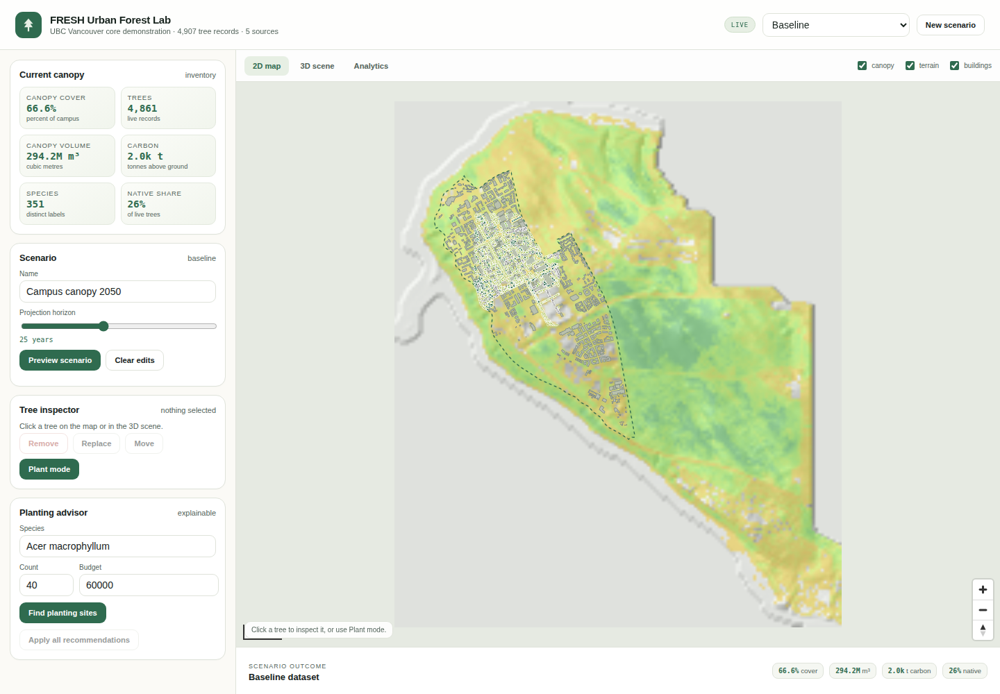
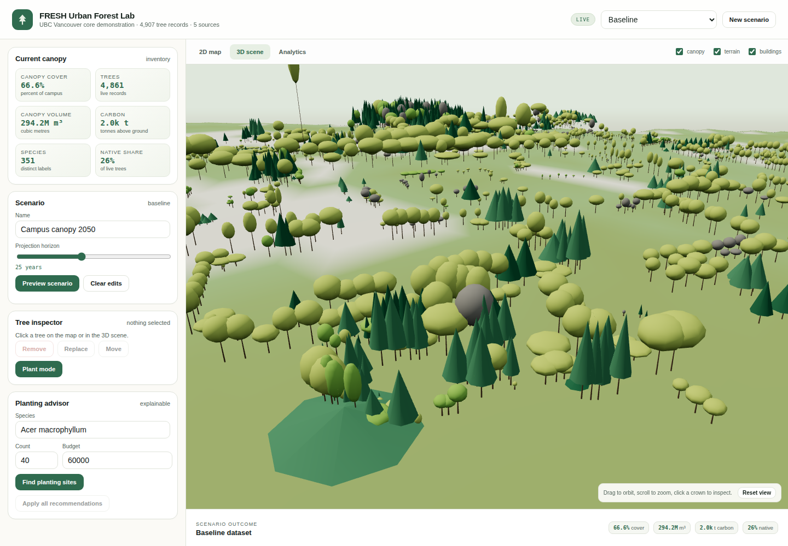

# FRESH Urban Forest Lab

An open, reproducible urban-forest modelling and decision-support lab. It links public
LiDAR, tree inventories, and individual-tree growth models to a 2D and 3D editing front
end so planners can measure canopy structure and test management scenarios.

**Documentation:** https://ubc-fresh.github.io/fresh-urban-forest-lab/

The first pilot is UBC's Vancouver campus and the surrounding Metro Vancouver context.
The demo runs offline from a small, derived core-campus dataset.





## What it does

- **Resolves and materializes public data.** A source catalog records the publisher,
  licence, CRS, and products. Downloads are resumable, hashed, and recorded in a
  materialization manifest.
- **Builds a portable dataset.** Trees, terrain, canopy height, buildings, and a boundary
  become a directory with one manifest and a file map.
- **Measures canopy structure.** Raster cover, canopy-volume prism, height percentiles,
  species composition, size classes, native share, Shannon diversity, and above-ground
  carbon.
- **Detects individual crowns.** A local-maximum plus marker-controlled watershed
  implementation on the CHM, with no R or Cython dependency.
- **Compares repeat measures.** Three UBC products on a common 2 km mask: 2015↔2016,
  2015↔2021, and 2016↔2021, with gain/loss/net and height change kept visible.
- **Projects scenarios.** Plant, remove, replace, and move trees; grow them year by year;
  compare canopy, carbon, diversity, cost, and a transparent DSS score.
- **Edits a 2D and 3D landscape.** MapLibre for the map, Three.js instanced trees over a
  terrain mesh for the 3D scene, shared selection, and a FastAPI backend.
- **Answers questions locally.** The `+ Ask` assistant runs the local OpenCode CLI with
  live dataset, tree, and scenario context.

## Quick start

```bash
python -m venv .venv
. .venv/bin/activate
python -m pip install -e ".[dev,web,optimize]"
fresh-urban-forest serve --dataset data/demo/ubc_core --port 8000
```

Open `http://127.0.0.1:8000`. The demo needs no external basemap or tile service.

Build a dataset from public sources:

```bash
fresh-urban-forest catalog list
fresh-urban-forest catalog fetch --all-direct --dest data/raw
fresh-urban-forest build \
  --ubc-trees data/raw/ubcv_campus_trees.geojson \
  --buildings data/raw/ubcv_buildings.geojson \
  --boundary data/raw/ubcv_legal_boundary.geojson \
  --dem data/raw/DEM_1m.tif \
  --chm data/raw/CHM_1m.tif \
  --out data/processed/ubc_lidar_2021 \
  --name "UBC Vancouver LiDAR 2021"
```

## Status

The prototype is complete through Phase 7 (shade, species fit, water, and irrigation) on
`main`. P8 (Fresh Solutions optimization and Pareto explorer) is active. Phase 5 is a
release candidate at v0.2.0; the tag and GitHub release await approval. The documentation
site is live on GitHub Pages. `ROADMAP.md` is the
plan of record; the GitHub issues carry the live status.

## Repository map

| Path | Purpose |
| --- | --- |
| `AGENTS.md` | Operating contract for coding agents |
| `ROADMAP.md` | Phases, tasks, and the issue tracker map |
| `CHANGE_LOG.md` | Dated narrative of changes |
| `notes/` | ADRs, data-source notes, software-landscape review, architecture |
| `docs/` | Sphinx site: guides, reference contracts, agent protocol, API |
| `src/fresh_urban_forest/` | Typed core, CLI, FastAPI service, vendored web assets |
| `data/demo/ubc_core/` | Small derived UBC core-campus demonstration dataset |
| `scripts/` | Workflow validator and green dashboard |
| `tests/` | Unit, contract, CLI, spatial, service, and static tests |
| `DATA_LICENSES.md` | Source licences and attribution |

## Design lineage

The project is seeded from `UBC-FRESH/ubc-fresh-dev-workflow` and uses its phase/task
model, green dashboard, validator, and agent contract. It borrows design patterns from
FEMIC (materialization), FHOPS (validated edits and tree scenes), WS4 (compiled-dataset
manifests), and fresh-fvsbc (provenance). It does **not** take a hard dependency on any of
them. The urban-forest software and method landscape, including what we refused to copy, is
in `notes/reference/software-landscape.md`.

## Limitations

- Growth is a transparent allometric scenario model, not a calibrated FVS or i-Tree
  projection.
- Carbon is above-ground only and uses generalized Jenkins equations.
- Individual-tree detection is a first-pass CHM method; dense multi-layer stands and steep
  terrain will merge or split crowns.
- The demo is a downsampled core-campus snapshot, not the full UBC or Metro Vancouver
  coverage.
- There are no user accounts, work orders, risk assessment, or multi-tenant deployment.

## Licence and citation

MIT. Copyright (c) 2026 UBC FRESH Lab. Public data keep their own licences; see
`DATA_LICENSES.md`. Cite the repository with `CITATION.cff`.
